<div align="center">

# 📊 Log File Analysis System

**A distributed big-data pipeline that parses web-server logs stored in HDFS to uncover error patterns, traffic peaks, top resources and anomalies, built on Hadoop and Spark and presented through an interactive web dashboard.**


<br/>


[Overview](#-overview) •
[Features](#-features) •
[Architecture](#-architecture) •
[Quick Start](#-quick-start) •
[Pipeline](#-running-the-pipeline) •
[Dashboard](#-dashboard) •
[Project Structure](#-project-structure)

</div>

---

## 📌 Overview

Web servers produce millions of log lines a day. Read one at a time they tell you little; together they show how a system is used and where it breaks.

**Log File Analysis System** loads raw server access logs into the **Hadoop Distributed File System (HDFS)** and processes them with **Apache Spark** and **Hadoop MapReduce**. It answers questions like these:

- ❗ **How often do errors happen**, which status codes, and which resources cause them?
- 📈 **When does traffic peak**, by minute, hour, day and day of the week?
- 🏆 **Which resources and hosts** generate the most requests and bandwidth?
- 🚨 **When did something unusual happen**: sudden spikes, drops, or complete outages?

The results are exported to a lightweight serving layer and explored through a **Flask + Chart.js dashboard**.

### Dataset

The system is demonstrated on the public **[NASA-HTTP web server logs](https://ita.ee.lbl.gov/html/contrib/NASA-HTTP.html)** (July and August 1995): about **3.4 million requests** to NASA Kennedy Space Center's web server, in Apache Common Log Format.

```text
199.72.81.55 - - [01/Jul/1995:00:00:01 -0400] "GET /history/apollo/ HTTP/1.0" 200 6245
```

---

## ✨ Features

| | Feature | Description |
|---|---|---|
| 🗄️ | **Distributed storage** | Raw and processed logs live on HDFS; processed data is stored as columnar **Parquet**, partitioned by date |
| 🧹 | **Robust parsing & data quality** | A single shared parser for both engines; malformed lines are kept in a *rejected* dataset with a reason code and reported, never silently dropped |
| ❗ | **Error analysis** | Status code distribution, hourly 4xx / 5xx error rates, most frequent broken links (404), hosts producing the most errors |
| 📈 | **Traffic analysis** | Requests, bandwidth and unique hosts per hour and day; hour-of-day and day-of-week profiles; top-K peak minutes, hours and days |
| 🏆 | **Top-N insights** | Most requested resources (by hits and by bytes), most active hosts, breakdown by resource type |
| 🚨 | **Anomaly detection** | Seasonal z-score that compares each hour with the same hour over the previous 7 days, plus gap detection that flags outages |
| ⚖️ | **Spark vs MapReduce** | The same analyses written as Hadoop Streaming MapReduce jobs; results checked against each other and runtimes benchmarked |
| 🖥️ | **Interactive dashboard** | Ten-page web dashboard that follows the pipeline stage by stage, with KPIs, time-series, filters, light and dark mode and a plain-language guide, served by a documented REST API |
| 🐳 | **One-command cluster** | Complete Hadoop + Spark cluster in Docker, with `lite` (≈8 GB RAM) and `full` profiles |
| 🔁 | **Reproducible pipeline** | One CLI runs every stage end to end, or any single stage, against a local sample or the full cluster |

---

## 🏗️ Architecture

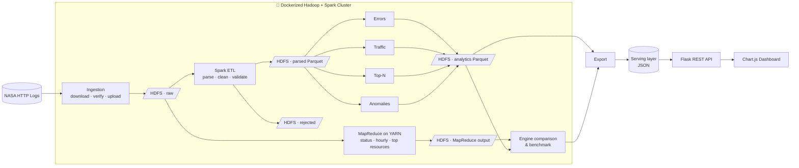

### Data layers

| Layer | Location | Format | Contents |
|---|---|---|---|
| **Raw** | `/logs/raw/` | Text | Original log files, decompressed so HDFS can split them into blocks |
| **Parsed** | `/logs/parsed/` | Parquet, partitioned by `log_date` | Typed, cleaned records with derived fields (`status_class`, `is_error`, `resource_type`, …) |
| **Rejected** | `/logs/rejected/` | Parquet | Unparseable lines with a reason code |
| **Analytics** | `/logs/analytics/<table>/` | Parquet | Aggregated result tables, one folder per table |
| **MapReduce** | `/logs/mapreduce/<job>/` | Text | Output of the Hadoop Streaming jobs |
| **Serving** | `data/serving/` | JSON | Small exported tables plus a manifest, read by the dashboard |

### Design principles

- **One parser, one source of truth.** Spark and MapReduce share the same parsing module, and a parity test proves they agree.
- **Logic is separate from I/O.** Every Spark job is built from pure DataFrame transformations that can be tested without a cluster.
- **Everything is configured.** Paths, thresholds and Top-N sizes live in `config/pipeline.yaml`; the same code runs on `file://` and `hdfs://`.
- **Modules talk through contracts.** Modules communicate only through documented schemas ([`docs/contracts/`](docs/contracts/)).
- **Every stage is idempotent.** Re-running a stage replaces its own output and touches nothing else.

---

## 🧰 Tech Stack

| Layer | Technology |
|---|---|
| Storage | **Apache Hadoop HDFS** |
| Resource management | **Apache Hadoop YARN** |
| Batch processing | **Apache Spark (PySpark)** · **Hadoop MapReduce (Hadoop Streaming, Python)** |
| Data format | **Apache Parquet** · JSON (serving) |
| Backend | **Flask** (REST API) |
| Frontend | **Jinja2** · **Chart.js** · HTML/CSS/JavaScript |
| Infrastructure | **Docker** · **Docker Compose** |
| Quality | **pytest** · **ruff** · **GitHub Actions** |

> Exact pinned versions are listed in [`docs/VERSIONS.md`](docs/VERSIONS.md).

---

## 🚀 Quick Start

### Prerequisites

| Requirement | Notes |
|---|---|
| **Docker Desktop** (or Docker Engine + Compose v2) | On Windows, use the WSL 2 backend |
| **RAM** | ~8 GB free for the `lite` profile · 16 GB recommended for `full` |
| **Disk** | ~15 GB free on the drive that holds Docker's data (image ~3 GB, build cache ~6 GB, HDFS + dataset ~2 GB) |
| **Git** | |
| *Optional:* **Python 3.10+** and **Java 17** | Only needed to run jobs locally without the cluster. On Windows, prefer the container (see below) |

> **Windows notes**
> - Use Docker Desktop with the **WSL 2** backend. The commands in this README work the same in PowerShell; you do not need Python or Java on the host.
> - Clone normally: `.gitattributes` keeps `.py` and `.sh` files on LF line endings, which the Linux containers require.
> - Docker's VM needs about **8 GB**. WSL 2 defaults to half your RAM, so on a smaller laptop create `%UserProfile%\.wslconfig` containing `[wsl2]` and `memory=8GB`, then run `wsl --shutdown`.
> - Build the image **once** before the first `up`: `docker compose -f infra/docker-compose.yml --profile lite build client` (it downloads about 1 GB of Hadoop and Spark; ~10 minutes). Every service uses that same image, and letting `up` build it for all services in parallel filled a laptop's disk on the first Windows run. Later starts are fast.
> - Docker keeps its data on C: by default. If C: is short of space, move it in **Docker Desktop → Settings → Resources → Advanced → Disk image location** before building.
> - To run Python jobs and tests without starting the cluster (and without installing PySpark, which needs extra Hadoop binaries on Windows), use the container:
>   `docker compose -f infra/docker-compose.yml --profile lite run --rm --no-deps client python -m pytest`
>   or `... client python -m loganalysis.etl.parse_logs --env local`. Your files stay on the host and are mounted into the container.

### 1. Clone the repository

```bash
git clone https://github.com/Madhav064/Log-File-Analysis-System.git
cd Log-File-Analysis-System
```

### 2. Start the cluster

```bash
docker compose -f infra/docker-compose.yml --profile lite build client
```

```bash
docker compose -f infra/docker-compose.yml --profile lite up -d --wait
```

> The first command builds the one image all services share (only needed the first time, ~10 minutes). `--wait` returns once every service is healthy.

> Use `--profile full` on machines with 16 GB+ RAM for two DataNodes and two Spark workers.

### 3. Run the complete pipeline

```bash
docker compose -f infra/docker-compose.yml exec client python scripts/pipeline.py all --env cluster
```

This downloads the dataset, loads it into HDFS, runs the Spark ETL and analytics, runs the MapReduce jobs, compares the two engines, and exports the results for the dashboard.

### 4. Open the dashboard

**To open it, follow these steps:**

1. **Start Docker Desktop** and wait until it says it is running.
2. **Open a terminal** in the project folder (`Log-File-Analysis-System`) and run:

   ```bash
   docker compose -f infra/docker-compose.yml --profile lite up -d dashboard
   ```

   The first time, Docker builds a small image and this takes about a minute. After that it starts in seconds.
3. **Open your browser** and go to **http://localhost:5000** 🎉
4. **To stop it** when you are done:

   ```bash
   docker compose -f infra/docker-compose.yml stop dashboard
   ```

> **Do you see "No data yet"?** The dashboard only shows results the pipeline has exported to `data/serving/`. If that folder is empty (for example on a fresh clone), run the pipeline once (step 3 above, about 45 minutes), then reload the page. You don't need to keep the cluster running afterwards: the dashboard only reads those exported files.

New to the dashboard? The **Guide** in its sidebar ([`docs/dashboard-guide.md`](docs/dashboard-guide.md)) explains every page, chart and term in plain words.

### Cluster web UIs

| Service | URL |
|---|---|
| 📊 Dashboard | http://localhost:5000 |
| 🗄️ HDFS NameNode | http://localhost:9870 |
| 🧮 YARN ResourceManager | http://localhost:8088 |
| ⚡ Spark Master | http://localhost:8080 |
| 📜 MapReduce Job History | http://localhost:19888 *(full profile)* |

### Stopping the cluster

```bash
docker compose -f infra/docker-compose.yml down
```

> Add `-v` to also delete the HDFS volumes and start from a clean slate.

---

## ⚙️ Running the Pipeline

Every stage can be run on its own through the pipeline CLI:

| Command | What it does |
|---|---|
| `pipeline.py all` | Runs every stage below, in order |
| `pipeline.py ingest` | Downloads the logs, verifies checksums and uploads them to HDFS |
| `pipeline.py etl` | Parses raw logs into Parquet, plus the rejected set and data-quality report |
| `pipeline.py analytics` | Runs the errors, traffic, top-N and anomaly jobs (`--only errors,traffic` to pick some) |
| `pipeline.py mapreduce` | Runs the Hadoop Streaming jobs on YARN |
| `pipeline.py compare` | Checks Spark against MapReduce results and benchmarks runtimes |
| `pipeline.py export` | Exports analytics tables to the dashboard's serving layer |

Examples:

```bash
# Re-run only the anomaly detection job on the cluster
docker compose -f infra/docker-compose.yml exec client python scripts/pipeline.py analytics --only anomalies --env cluster
```

```bash
# Develop locally on the bundled sample, no Docker required
pip install -r requirements/jobs.txt
python scripts/pipeline.py etl --env local
python scripts/pipeline.py analytics --env local
```

### Configuration

All tunable settings live in [`config/pipeline.yaml`](config/pipeline.yaml):

| Setting | Purpose |
|---|---|
| `paths.<env>.*` | Input and output locations for `local` and `cluster` |
| `timezone` | Time zone used for hourly and daily aggregation (server local time) |
| `top_n` | Number of entries in each Top-N table |
| `peaks_top_k` | Number of busiest minutes, hours and days kept in the peaks table |
| `anomaly.z_threshold` | Z-score above which an hour is flagged |
| `anomaly.baseline_days` | Number of previous same-hour values used as the baseline |
| `anomaly.min_baseline_points` | Minimum number of real (non-outage) baseline values an hour needs before it is scored |
| `anomaly.min_requests` | Minimum requests in an hour before its error rate is evaluated |

---

## 🖥️ Dashboard

| | |
|---|---|
| **01 · Overview** | **02 · Architecture** |
| 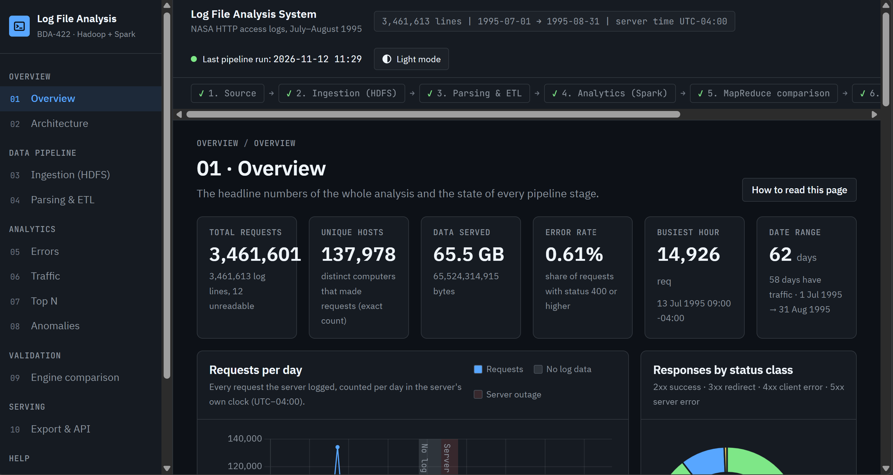 | 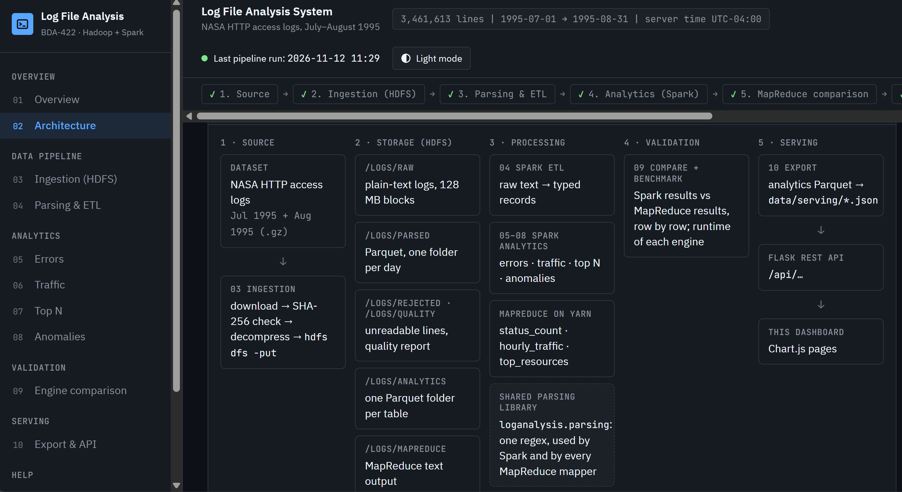 |
| **03 · Ingestion (HDFS)** | **04 · Parsing & ETL** |
| 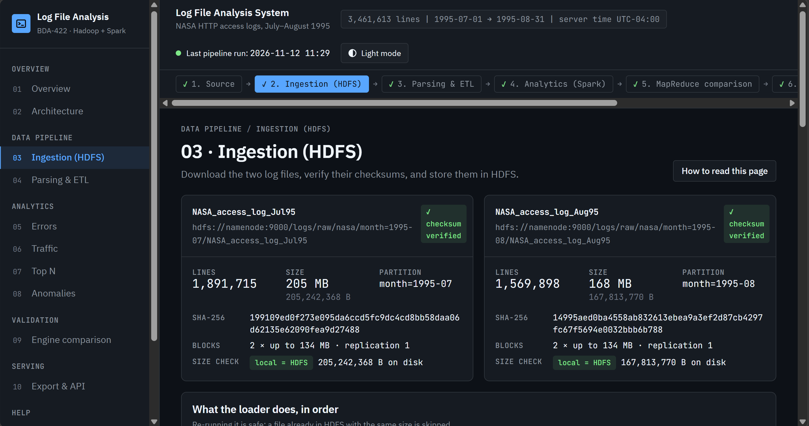 | 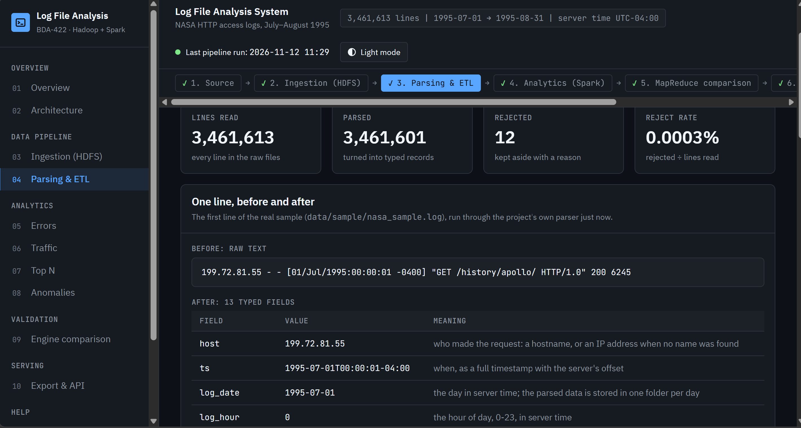 |
| **05 · Errors** | **06 · Traffic** |
| 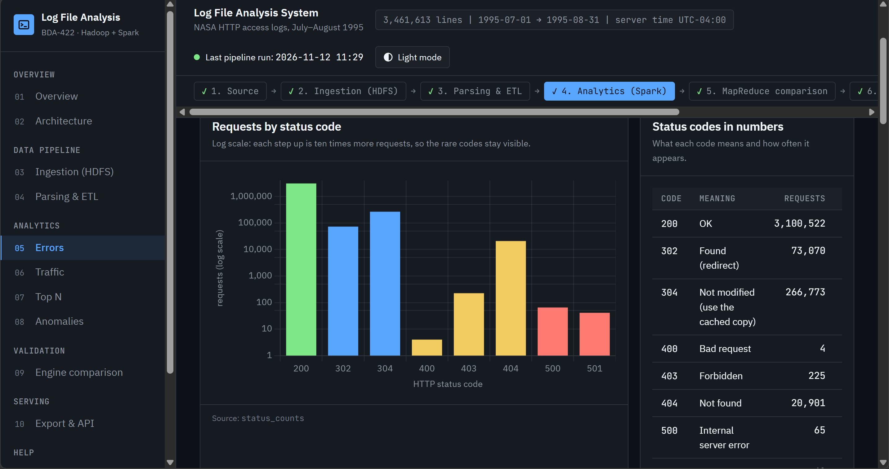 | 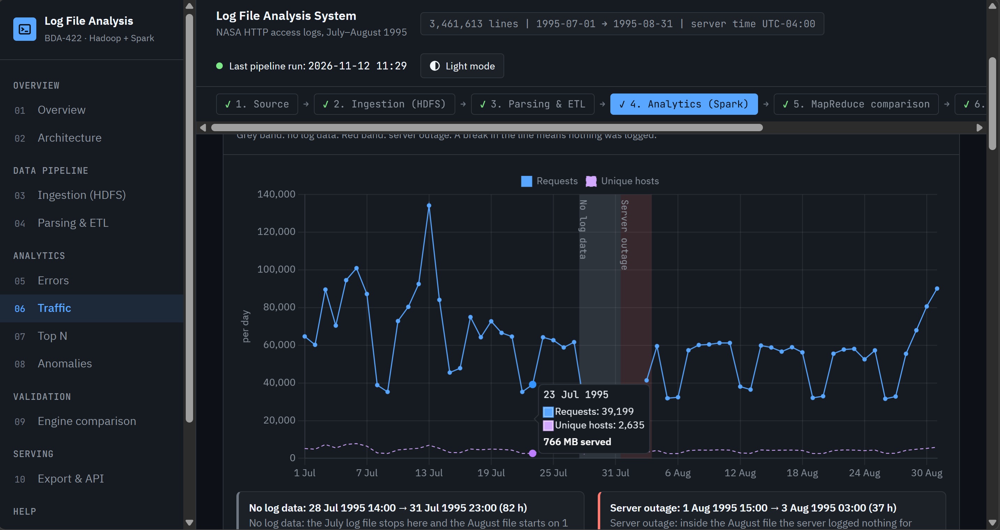 |
| **07 · Top N** | **08 · Anomalies** |
| 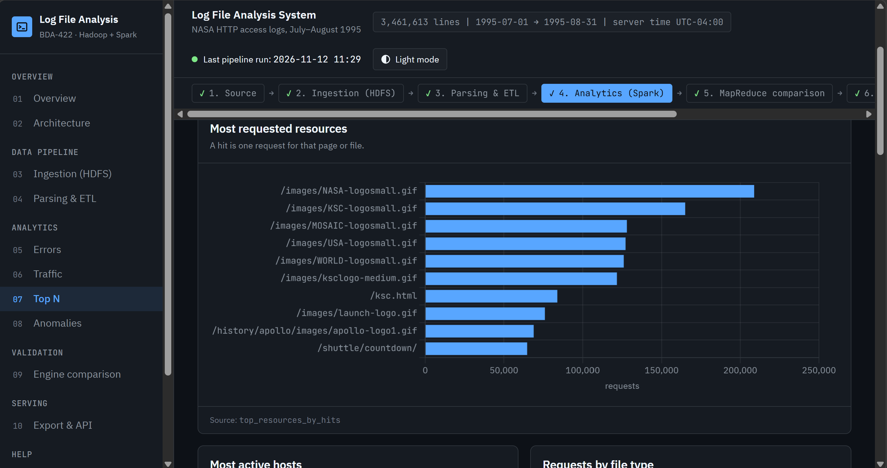 | 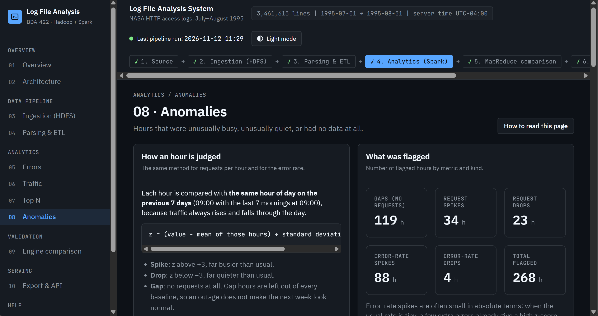 |
| **09 · Engine comparison** | **10 · Export & API** |
| 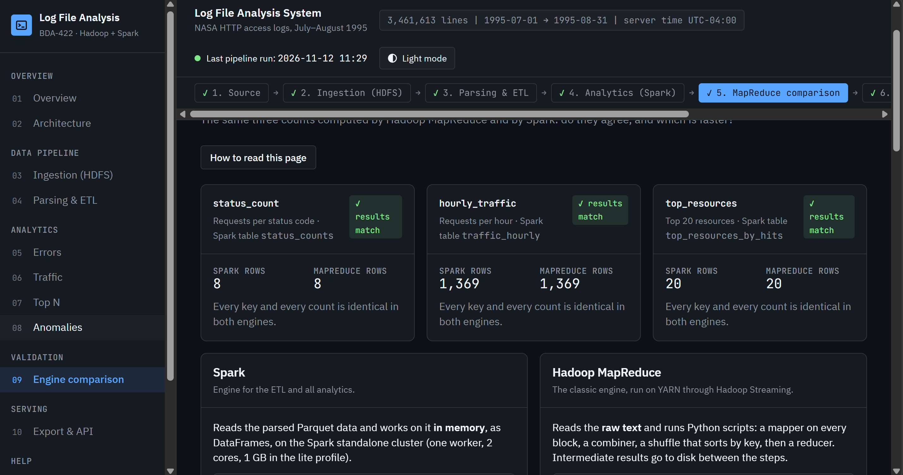 | 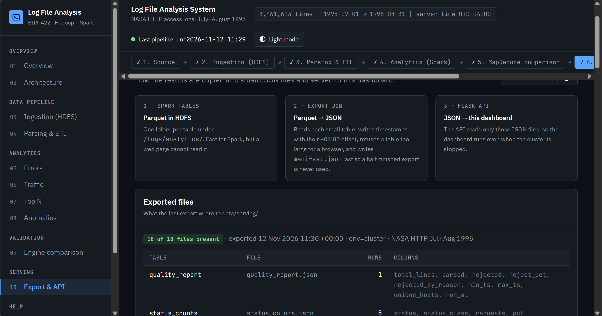 |

Screenshots of every page in both modes are in [`docs/images/`](docs/images/), taken on the real full-data run.

The pages follow the pipeline in order (sidebar 01–10), and a stepper along the top shows every stage. Each page ends with a **Stage details** panel: its input and output paths, the job that produced it with its last runtime, and the schema of every table it shows. Light and dark mode follow the system setting, and a toggle in the top bar overrides it.

| # | Page | What you'll find |
|---|---|---|
| 01 | **Overview** | KPI cards (requests, unique hosts, data served, error rate, busiest hour, date range), daily traffic with the data gap and outage marked, status-class split, findings, pipeline-at-a-glance |
| 02 | **Architecture** | Data-flow diagram from source to dashboard, technology stack, cluster services and their web UIs |
| 03 | **Ingestion (HDFS)** | Each raw file with its line count, size and verified SHA-256; HDFS blocks, replication and `fsck` health |
| 04 | **Parsing & ETL** | A real log line before and after parsing, parsed vs rejected lines with reasons, data-quality checks |
| 05 | **Errors** | Status code breakdown, 4xx / 5xx error rate over time, top broken links (404) and top error-producing hosts |
| 06 | **Traffic** | Hourly / daily traffic with a date-range filter, hour-of-day and day-of-week profiles, ranked peak periods |
| 07 | **Top N** | Most requested resources (by hits or bytes), most active hosts, file-type breakdown, adjustable N |
| 08 | **Anomalies** | The z-score method, counts by kind, hourly traffic with spikes, drops and gaps marked, the full list of flagged hours |
| 09 | **Engine comparison** | Spark vs MapReduce: do the results match, how each engine works, runtime benchmark |
| 10 | **Export & API** | How results reach the dashboard, the exported files, and a live explorer for every API endpoint |
| ? | **Guide** | The plain-language guide ([`docs/dashboard-guide.md`](docs/dashboard-guide.md)) |

### REST API

The dashboard is backed by a JSON API that can also be used directly:

| Endpoint | Description |
|---|---|
| `GET /api/summary` | Headline KPIs |
| `GET /api/errors/status` | Requests per HTTP status code |
| `GET /api/errors/timeline?granularity=hour&from=&to=` | Error counts and error rate over time |
| `GET /api/errors/top-resources?n=10` | Resources returning the most errors |
| `GET /api/errors/top-hosts?n=10` | Hosts producing the most errors |
| `GET /api/traffic/timeline?granularity=day&from=&to=` | Requests, bytes and unique hosts over time |
| `GET /api/traffic/profile?by=hour` | Hour-of-day or day-of-week profile |
| `GET /api/traffic/peaks?granularity=hour` | Busiest periods, ranked |
| `GET /api/top/resources?by=hits&n=10` | Top resources by hits or bytes |
| `GET /api/top/hosts?n=10` | Most active hosts |
| `GET /api/top/resource-types` | Requests and bytes by resource type |
| `GET /api/anomalies?metric=requests&kind=spike` | Detected anomalies |
| `GET /api/pipeline/quality` | Data-quality report |
| `GET /api/pipeline/benchmark` | Spark vs MapReduce benchmark |
| `GET /api/pipeline/ingestion` | Files stored in HDFS: sizes, checksums, blocks, `fsck` status |
| `GET /api/pipeline/runs` | Runtime and result of every pipeline job |
| `GET /api/meta/stages` | The dashboard's stages with their paths and table schemas |
| `GET /api/health` | Which exported files exist and when they were written |

---

## 🔍 How It Works

<details>
<summary><b>1. Ingestion</b></summary>

The dataset is downloaded and verified against SHA-256 checksums. It is then decompressed (gzip files cannot be split, so a compressed file would force a single task) and uploaded to HDFS, where it is stored as replicated 128 MB blocks that Spark and MapReduce process in parallel.

</details>

<details>
<summary><b>2. Parsing & data quality (Spark ETL)</b></summary>

Each line is matched against the Common Log Format using Spark's native `regexp_extract`. Fields are typed, timestamps are converted to server local time, and derived columns are added: status class, error flag, resource type, hour and date. Lines that fail validation are written to a rejected dataset with a reason code, and a data-quality report records parsed vs rejected counts.

</details>

<details>
<summary><b>3. Analytics (Spark)</b></summary>

Four independent jobs read the parsed Parquet data and produce aggregated tables: **errors** (status distribution, error-rate timeline, broken links), **traffic** (time series, daily and weekly profiles, ranked peaks using window functions), **top-N** (resources, hosts, resource types) and **anomalies**.

</details>

<details>
<summary><b>4. Anomaly detection</b></summary>

A complete hourly calendar is built so missing hours appear as zero rather than disappearing. Hours with no traffic are flagged as **gaps** (outages). For request volume and error rate, each hour is compared against the **same hour of day over the previous 7 days**. If its z-score passes the configured threshold, it is flagged as a **spike** or a **drop**. This accounts for the natural day/night cycle of web traffic without needing an ML library.

</details>

<details>
<summary><b>5. MapReduce & engine comparison</b></summary>

Status counts, hourly traffic and top resources are also implemented as **Hadoop Streaming** jobs in Python, with combiners and a two-stage top-N. They run on YARN and use the same parser as Spark. A comparison step checks that both engines produce identical results and benchmarks their runtimes on the same input.

</details>

<details>
<summary><b>6. Serving & visualization</b></summary>

The small analytics tables are exported to JSON with a manifest. The Flask backend loads them through a single repository layer, filters them in memory, and serves them over a REST API. Chart.js renders them as interactive charts.

</details>

---

## 📁 Project Structure

```text
Log-File-Analysis-System/
├── config/
│   └── pipeline.yaml            # paths, thresholds, Top-N size, time zone
├── infra/
│   ├── docker-compose.yml       # Hadoop + Spark + dashboard (lite / full profiles)
│   ├── hadoop/                  # Hadoop image and *-site.xml configuration
│   └── spark/                   # Spark image and configuration
├── src/loganalysis/             # core Python package
│   ├── common/                  # config, Spark session, paths, logging
│   ├── parsing/                 # shared log parser and schemas
│   ├── ingestion/               # download and HDFS loading
│   ├── etl/                     # raw → parsed Spark job
│   ├── analytics/               # errors, traffic, top-N, anomalies
│   └── export/                  # analytics → serving JSON
├── mapreduce/                   # Hadoop Streaming jobs (mappers / reducers)
│   ├── status_count/
│   ├── hourly_traffic/
│   └── top_resources/
├── scripts/
│   ├── pipeline.py              # pipeline CLI
│   └── compare_engines.py       # Spark vs MapReduce validation and benchmark
├── dashboard/                   # Flask + Chart.js web app
│   ├── app/
│   │   ├── api/                 # REST endpoints
│   │   ├── views/               # page routes
│   │   ├── services/            # data repository
│   │   ├── templates/
│   │   └── static/
│   └── tests/
├── tests/                       # unit and integration tests
├── data/
│   └── sample/                  # small sample log for local development
├── docs/                        # plan, contracts, versions, demo script
└── requirements/                # Python dependencies per component
```

---

## 🧪 Testing

```bash
pip install -r requirements/dev.txt
pytest
```

| Suite | Covers |
|---|---|
| **Parser** | Valid lines, every malformed-line case, rejection reasons |
| **Spark transformations** | Each analytics function on small hand-built DataFrames |
| **Integration** | ETL → analytics on the bundled sample, checked against the data contracts |
| **MapReduce** | Mapper → sort → reducer runs, and parity with Spark output |
| **API** | Every endpoint, parameter validation and error responses |

Linting and tests run automatically on every pull request through **GitHub Actions**.

---

## 📚 Documentation

| Document | Description |
|---|---|
| [`docs/PROJECT_PLAN.md`](docs/PROJECT_PLAN.md) | Full design: architecture, modules, decisions, timeline |
| [`docs/TEAM_TASKS.md`](docs/TEAM_TASKS.md) | Work breakdown and ownership |
| [`docs/contracts/`](docs/contracts/) | Data schemas, HDFS layout and API contract |
| [`docs/VERSIONS.md`](docs/VERSIONS.md) | Pinned versions of every component |
| [`docs/demo-script.md`](docs/demo-script.md) | Step-by-step demo walkthrough |

---

## 🙏 Acknowledgements

- **NASA Kennedy Space Center** and the **Internet Traffic Archive** for publishing the NASA-HTTP logs.
- The **Apache Hadoop** and **Apache Spark** communities.

<div align="center">

---

*Built as a semester project for the course **Big Data Analytics**.*

</div>
