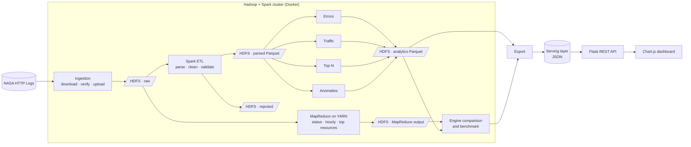

# Log File Analysis System

A distributed batch pipeline that parses web-server access logs stored in HDFS and reports error frequency, traffic peaks, top resources and anomalies. Processing is done with Apache Spark and Hadoop MapReduce, and the results are presented through a web dashboard.

### [Project Report (PDF)](https://drive.google.com/file/d/1VSXteTOCxhM4lfzuRgLph6ip0VKP2PNj/view?usp=sharing)

**Course:** CSBB 422 – Big Data Analytics, Department of Computer Science and Engineering, National Institute of Technology Delhi

**Stack:** Hadoop 3.4 (HDFS, YARN, MapReduce) · Spark 3.5 (PySpark) · Parquet · Flask · Chart.js · Docker Compose

## Contents

- [Overview](#overview)
- [Key Results](#key-results)
- [Features](#features)
- [Architecture](#architecture)
- [Tech Stack](#tech-stack)
- [Getting Started](#getting-started)
- [Running the Pipeline](#running-the-pipeline)
- [Dashboard](#dashboard)
- [How It Works](#how-it-works)
- [Project Structure](#project-structure)
- [Testing](#testing)
- [Documentation](#documentation)
- [Acknowledgements](#acknowledgements)

## Overview

Web servers write millions of log lines a day. A single line says little, but taken together they show how a system is used and where it fails.

This project loads raw access logs into the Hadoop Distributed File System (HDFS) and processes them with Apache Spark and Hadoop MapReduce to answer four questions:

- How often do errors occur, with which status codes, and on which resources?
- When does traffic peak, by minute, hour, day and day of the week?
- Which resources and hosts account for the most requests and bandwidth?
- When did something unusual happen, such as a sudden spike, a drop or an outage?

The results are exported to a small serving layer and explored through a Flask and Chart.js dashboard.

### Dataset

The system is evaluated on the public [NASA-HTTP web server logs](https://ita.ee.lbl.gov/html/contrib/NASA-HTTP.html) for July and August 1995: 3,461,613 requests to the NASA Kennedy Space Center web server (373 MB), in Apache Common Log Format.

```text
199.72.81.55 - - [01/Jul/1995:00:00:01 -0400] "GET /history/apollo/ HTTP/1.0" 200 6245
```

## Key Results

Figures from the full run on the complete dataset (Docker cluster, `lite` profile).

| Measure | Result |
|---|---|
| Lines parsed | 3,461,601 of 3,461,613 (12 rejected with a reason code) |
| Unique hosts | 137,978 |
| Data served | 65.5 GB |
| Error rate (4xx + 5xx) | 0.61%, of which 404 Not Found accounts for 20,901 requests |
| Busiest day | 13 July 1995, 134,203 requests |
| Busiest hour | 13 July 1995, 09:00–10:00, 14,926 requests |
| Anomalies flagged | 268 hours (119 gap hours, 57 request spikes or drops, 92 error-rate spikes or drops) |
| Spark vs MapReduce | Identical results on all three shared jobs; Spark 1.4× to 4.0× faster |
| Full pipeline runtime | 2,669 s, including a three-run benchmark of both engines |

The dataset contains two periods without traffic, which the anomaly job detects as gaps: 28 July 14:00 to 31 July 23:00 (no log data) and 1 August 15:00 to 3 August 03:00 (server outage).

## Features

| Feature | Description |
|---|---|
| Distributed storage | Raw and processed logs are stored on HDFS; processed data is columnar Parquet, partitioned by date |
| Parsing and data quality | One parser is shared by both engines. Malformed lines are kept in a rejected dataset with a reason code and reported, not silently dropped |
| Error analysis | Status code distribution, hourly 4xx and 5xx error rates, most frequent broken links (404) and the hosts producing the most errors |
| Traffic analysis | Requests, bandwidth and unique hosts per hour and per day; hour-of-day and day-of-week profiles; the busiest minutes, hours and days |
| Top-N analysis | Most requested resources (by hits and by bytes), most active hosts and a breakdown by resource type |
| Anomaly detection | A seasonal z-score that compares each hour with the same hour on the previous 7 days, and gap detection for outages |
| Spark vs MapReduce | The same analyses written as Hadoop Streaming jobs; results are checked against Spark and runtimes are benchmarked |
| Dashboard | Ten pages that follow the pipeline stage by stage, with KPIs, time series, filters, light and dark mode and a user guide, served by a REST API |
| Containerised cluster | A complete Hadoop and Spark cluster in Docker, with a `lite` profile (about 8 GB RAM) and a `full` profile |
| Reproducible pipeline | One command runs every stage end to end, or any single stage, against a local sample or the cluster |

## Architecture



### Data layers

| Layer | Location | Format | Contents |
|---|---|---|---|
| Raw | `/logs/raw/` | Text | Original log files, decompressed so that HDFS can split them into blocks |
| Parsed | `/logs/parsed/` | Parquet, partitioned by `log_date` | Typed, cleaned records with derived fields (`status_class`, `is_error`, `resource_type`, ...) |
| Rejected | `/logs/rejected/` | Parquet | Unparseable lines with a reason code |
| Analytics | `/logs/analytics/<table>/` | Parquet | Aggregated result tables, one folder per table |
| MapReduce | `/logs/mapreduce/<job>/` | Text | Output of the Hadoop Streaming jobs |
| Serving | `data/serving/` | JSON | Small exported tables and a manifest, read by the dashboard |

### Design principles

- **A single parser.** Spark and MapReduce use the same parsing module, and a parity test checks that they agree.
- **Logic separated from I/O.** Every Spark job is built from pure DataFrame transformations that can be tested without a cluster.
- **Configuration over code.** Paths, thresholds and Top-N sizes are set in `config/pipeline.yaml`; the same code runs on `file://` and `hdfs://`.
- **Explicit contracts.** Modules exchange data only through documented schemas ([`docs/contracts/`](docs/contracts/)).
- **Idempotent stages.** Re-running a stage replaces its own output and nothing else.

## Tech Stack

| Layer | Technology |
|---|---|
| Storage | Apache Hadoop HDFS |
| Resource management | Apache Hadoop YARN |
| Batch processing | Apache Spark (PySpark), Hadoop MapReduce (Hadoop Streaming, Python) |
| Data format | Apache Parquet, JSON (serving) |
| Backend | Flask (REST API) |
| Frontend | Jinja2, Chart.js, HTML, CSS, JavaScript |
| Infrastructure | Docker, Docker Compose |
| Quality | pytest, ruff, GitHub Actions |

Exact versions are listed in [`docs/VERSIONS.md`](docs/VERSIONS.md).

## Getting Started

### Prerequisites

| Requirement | Notes |
|---|---|
| Docker Desktop, or Docker Engine with Compose v2 | On Windows, use the WSL 2 backend |
| Memory | About 8 GB free for the `lite` profile; 16 GB recommended for `full` |
| Disk | About 15 GB free on the drive that holds Docker's data (image about 3 GB, build cache about 6 GB, HDFS and dataset about 2 GB) |
| Git | |
| Python 3.10+ and Java 11 or 17 (optional) | Only needed to run jobs locally without the cluster. On Windows, use the container instead (see below) |

**Notes for Windows**

- Use Docker Desktop with the WSL 2 backend. The commands below work the same in PowerShell; Python and Java are not needed on the host.
- Clone normally: `.gitattributes` keeps `.py` and `.sh` files on LF line endings, which the Linux containers require.
- Docker's VM needs about 8 GB of memory. WSL 2 defaults to half of the system RAM, so on a smaller machine create `%UserProfile%\.wslconfig` containing `[wsl2]` and `memory=8GB`, then run `wsl --shutdown`.
- Build the image once before the first `up` (step 2 below). Every service uses the same image, and letting `up` build it for all services in parallel can exhaust disk space on the first run.
- Docker stores its data on C: by default. If C: is short of space, change **Docker Desktop → Settings → Resources → Advanced → Disk image location** before building.
- To run Python jobs and tests without starting the cluster, use the client container. Project files stay on the host and are mounted into it:

  ```bash
  docker compose -f infra/docker-compose.yml --profile lite run --rm --no-deps client python -m pytest
  ```

### 1. Clone the repository

```bash
git clone https://github.com/Madhav064/Log-File-Analysis-System.git
cd Log-File-Analysis-System
```

### 2. Build the image and start the cluster

```bash
docker compose -f infra/docker-compose.yml --profile lite build client
```

```bash
docker compose -f infra/docker-compose.yml --profile lite up -d --wait
```

The build is needed only the first time; it downloads about 1 GB of Hadoop and Spark and takes around 10 minutes. `--wait` returns once every service is healthy. On machines with 16 GB of RAM or more, `--profile full` starts two DataNodes and two Spark workers.

### 3. Run the pipeline

```bash
docker compose -f infra/docker-compose.yml exec client python scripts/pipeline.py all --env cluster
```

This downloads the dataset, loads it into HDFS, runs the Spark ETL and analytics, runs the MapReduce jobs, compares the two engines and exports the results for the dashboard. On the full dataset it takes about 45 minutes, most of which is the benchmark.

### 4. Open the dashboard

```bash
docker compose -f infra/docker-compose.yml --profile lite up -d dashboard
```

Then open http://localhost:5000. The first start builds a small image and takes about a minute. To stop the dashboard:

```bash
docker compose -f infra/docker-compose.yml stop dashboard
```

The dashboard reads only the files the pipeline exports to `data/serving/`. If it shows "No data yet", run the pipeline once (step 3) and reload the page. The cluster does not need to stay running afterwards.

The **Guide** page in the dashboard ([`docs/dashboard-guide.md`](docs/dashboard-guide.md)) explains every page, chart and term.

### Web interfaces

| Service | URL |
|---|---|
| Dashboard | http://localhost:5000 |
| HDFS NameNode | http://localhost:9870 |
| YARN ResourceManager | http://localhost:8088 |
| Spark Master | http://localhost:8080 |
| MapReduce Job History | http://localhost:19888 (`full` profile) |

### Stopping the cluster

```bash
docker compose -f infra/docker-compose.yml down
```

Add `-v` to also delete the HDFS volumes and start from a clean state.

## Running the Pipeline

Each stage can be run on its own:

| Command | Description |
|---|---|
| `pipeline.py all` | Runs every stage below, in order |
| `pipeline.py ingest` | Downloads the logs, verifies checksums and uploads them to HDFS |
| `pipeline.py etl` | Parses raw logs into Parquet and writes the rejected set and data-quality report |
| `pipeline.py analytics` | Runs the errors, traffic, top-N and anomaly jobs (`--only errors,traffic` selects some of them) |
| `pipeline.py mapreduce` | Runs the Hadoop Streaming jobs on YARN |
| `pipeline.py compare` | Checks Spark results against MapReduce and benchmarks both |
| `pipeline.py export` | Exports the analytics tables to the dashboard's serving layer |

Re-run only the anomaly detection job on the cluster:

```bash
docker compose -f infra/docker-compose.yml exec client python scripts/pipeline.py analytics --only anomalies --env cluster
```

Run locally on the bundled sample, without Docker:

```bash
pip install -r requirements/jobs.txt
python scripts/pipeline.py etl --env local
python scripts/pipeline.py analytics --env local
```

### Configuration

All tunable settings are in [`config/pipeline.yaml`](config/pipeline.yaml):

| Setting | Purpose |
|---|---|
| `paths.<env>.*` | Input and output locations for `local` and `cluster` |
| `timezone` | Time zone used for hourly and daily aggregation (server local time) |
| `top_n` | Number of entries in each Top-N table |
| `peaks_top_k` | Number of busiest minutes, hours and days kept in the peaks table |
| `anomaly.z_threshold` | Z-score above which an hour is flagged |
| `anomaly.baseline_days` | Number of previous same-hour values used as the baseline |
| `anomaly.min_baseline_points` | Minimum number of non-outage baseline values an hour needs before it is scored |
| `anomaly.min_requests` | Minimum requests in an hour before its error rate is evaluated |

## Dashboard

| | |
|---|---|
| **01 · Overview** | **02 · Architecture** |
|  |  |
| **03 · Ingestion (HDFS)** | **04 · Parsing & ETL** |
|  |  |
| **05 · Errors** | **06 · Traffic** |
|  |  |
| **07 · Top N** | **08 · Anomalies** |
|  |  |
| **09 · Engine comparison** | **10 · Export & API** |
|  |  |

Screenshots of every page in light and dark mode, taken on the full-data run, are in [`docs/images/`](docs/images/).

The pages follow the pipeline in order, and a stepper at the top shows every stage. Each page ends with a **Stage details** panel listing its input and output paths, the job that produced it with its last runtime, and the schema of every table it shows. The colour scheme follows the system setting and can be switched from the top bar.

| # | Page | Contents |
|---|---|---|
| 01 | Overview | KPIs (requests, unique hosts, data served, error rate, busiest hour, date range), daily traffic with the data gap and outage marked, status-class split, key findings |
| 02 | Architecture | Data-flow diagram, technology stack, cluster services and their web interfaces |
| 03 | Ingestion (HDFS) | Each raw file with its line count, size and verified SHA-256; HDFS blocks, replication and `fsck` status |
| 04 | Parsing & ETL | A log line before and after parsing, parsed and rejected counts with reasons, data-quality checks |
| 05 | Errors | Status code breakdown, 4xx and 5xx error rate over time, top broken links (404), top error-producing hosts |
| 06 | Traffic | Hourly and daily traffic with a date-range filter, hour-of-day and day-of-week profiles, ranked peak periods |
| 07 | Top N | Most requested resources (by hits or bytes), most active hosts, file-type breakdown, adjustable N |
| 08 | Anomalies | The z-score method, counts by kind, hourly traffic with spikes, drops and gaps marked, the list of flagged hours |
| 09 | Engine comparison | Spark and MapReduce results side by side, how each engine works, runtime benchmark |
| 10 | Export & API | How results reach the dashboard, the exported files, and an explorer for every API endpoint |
| – | Guide | The user guide ([`docs/dashboard-guide.md`](docs/dashboard-guide.md)) |

### REST API

The dashboard is backed by a JSON API that can also be used directly:

| Endpoint | Description |
|---|---|
| `GET /api/summary` | Headline KPIs |
| `GET /api/errors/status` | Requests per HTTP status code |
| `GET /api/errors/timeline?granularity=hour&from=&to=` | Error counts and error rate over time |
| `GET /api/errors/top-resources?n=10` | Resources returning the most errors |
| `GET /api/errors/top-hosts?n=10` | Hosts producing the most errors |
| `GET /api/traffic/timeline?granularity=day&from=&to=` | Requests, bytes and unique hosts over time |
| `GET /api/traffic/profile?by=hour` | Hour-of-day or day-of-week profile |
| `GET /api/traffic/peaks?granularity=hour` | Busiest periods, ranked |
| `GET /api/top/resources?by=hits&n=10` | Top resources by hits or bytes |
| `GET /api/top/hosts?n=10` | Most active hosts |
| `GET /api/top/resource-types` | Requests and bytes by resource type |
| `GET /api/anomalies?metric=requests&kind=spike` | Detected anomalies |
| `GET /api/pipeline/quality` | Data-quality report |
| `GET /api/pipeline/benchmark` | Spark vs MapReduce benchmark |
| `GET /api/pipeline/ingestion` | Files stored in HDFS: sizes, checksums, blocks, `fsck` status |
| `GET /api/pipeline/runs` | Runtime and result of every pipeline job |
| `GET /api/meta/stages` | Dashboard stages with their paths and table schemas |
| `GET /api/health` | Which exported files exist and when they were written |

## How It Works

**1. Ingestion.** The dataset is downloaded and verified against SHA-256 checksums. It is then decompressed, because gzip files cannot be split and a compressed file would be processed by a single task, and uploaded to HDFS, where it is stored as 128 MB blocks that Spark and MapReduce process in parallel.

**2. Parsing and data quality (Spark ETL).** Each line is matched against the Common Log Format with Spark's native `regexp_extract`. Fields are typed, timestamps are converted to server local time, and derived columns are added: status class, error flag, resource type, hour and date. Lines that fail validation are written to a rejected dataset with a reason code, and a data-quality report records the parsed and rejected counts.

**3. Analytics (Spark).** Four independent jobs read the parsed Parquet data and write aggregated tables: errors (status distribution, error-rate timeline, broken links), traffic (time series, daily and weekly profiles, ranked peaks using window functions), top-N (resources, hosts, resource types) and anomalies.

**4. Anomaly detection.** A complete hourly calendar is built so that missing hours appear as zero instead of disappearing. Hours with no traffic are flagged as gaps. For request volume and error rate, each hour is compared with the same hour of day on the previous 7 days, and an hour whose z-score exceeds the configured threshold is flagged as a spike or a drop. Comparing like hours accounts for the daily cycle of web traffic without a machine-learning library.

**5. MapReduce and engine comparison.** Status counts, hourly traffic and top resources are also implemented as Hadoop Streaming jobs in Python, with combiners and a two-stage top-N. They run on YARN and use the same parser as Spark. A comparison step checks that both engines produce identical results and benchmarks their runtimes on the same input.

**6. Serving and visualisation.** The analytics tables are exported to JSON with a manifest. The Flask backend loads them through a single repository layer, filters them in memory and serves them over the REST API, and Chart.js renders the charts.

## Project Structure

```text
Log-File-Analysis-System/
├── config/
│   └── pipeline.yaml            # paths, thresholds, Top-N size, time zone
├── infra/
│   ├── docker-compose.yml       # Hadoop + Spark + dashboard (lite / full profiles)
│   ├── Dockerfile               # one image for every Hadoop and Spark service
│   ├── hadoop/                  # Hadoop *-site.xml configuration
│   └── spark/                   # Spark configuration
├── src/loganalysis/             # core Python package
│   ├── common/                  # config, Spark session, paths, logging
│   ├── parsing/                 # shared log parser and schemas
│   ├── ingestion/               # download and HDFS loading
│   ├── etl/                     # raw → parsed Spark job
│   ├── analytics/               # errors, traffic, top-N, anomalies
│   └── export/                  # analytics → serving JSON
├── mapreduce/                   # Hadoop Streaming jobs (mappers and reducers)
│   ├── status_count/
│   ├── hourly_traffic/
│   └── top_resources/
├── scripts/
│   ├── pipeline.py              # pipeline command-line interface
│   └── compare_engines.py       # Spark vs MapReduce validation and benchmark
├── dashboard/                   # Flask + Chart.js web application
│   ├── app/
│   │   ├── api/                 # REST endpoints
│   │   ├── views/               # page routes
│   │   ├── services/            # data repository
│   │   ├── templates/
│   │   └── static/
│   └── tests/
├── tests/                       # unit and integration tests
├── data/
│   └── sample/                  # small sample log for local development
├── docs/                        # plan, contracts, versions, demo script
└── requirements/                # Python dependencies per component
```

## Testing

```bash
pip install -r requirements/dev.txt
pytest
```

| Suite | Covers |
|---|---|
| Parser | Valid lines, every malformed-line case, rejection reasons |
| Spark transformations | Each analytics function on small hand-built DataFrames |
| Integration | ETL and analytics on the bundled sample, checked against the data contracts |
| MapReduce | Mapper, sort and reducer runs, and parity with the Spark output |
| API | Every endpoint, parameter validation and error responses |

Linting and tests run on every push through GitHub Actions.

## Documentation

| Document | Description |
|---|---|
| [`docs/PROJECT_PLAN.md`](docs/PROJECT_PLAN.md) | Full design: architecture, modules, decisions, timeline |
| [`docs/TEAM_TASKS.md`](docs/TEAM_TASKS.md) | Work breakdown and ownership |
| [`docs/contracts/`](docs/contracts/) | Data schemas, HDFS layout and API contract |
| [`docs/VERSIONS.md`](docs/VERSIONS.md) | Pinned versions of every component |
| [`docs/dashboard-guide.md`](docs/dashboard-guide.md) | User guide for the dashboard |
| [`docs/demo-script.md`](docs/demo-script.md) | Step-by-step demo walkthrough |

## Acknowledgements

- NASA Kennedy Space Center and the Internet Traffic Archive, for publishing the NASA-HTTP logs.
- The Apache Hadoop and Apache Spark projects.
