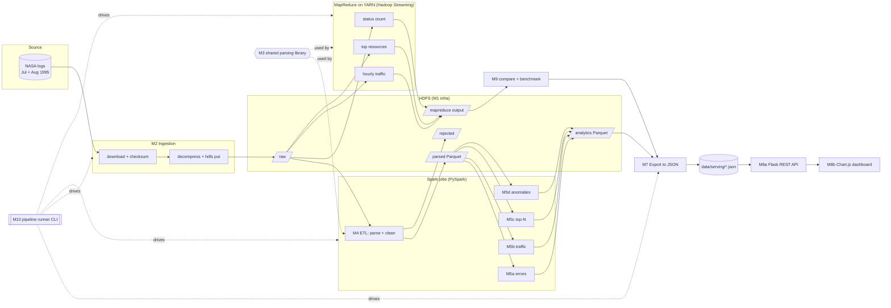

# Log File Analysis System — Project Plan

> **Subject:** Big Data Analytics (semester project)
> **Problem statement:** Parse server logs stored in HDFS to find error frequency, traffic peaks, etc.
> **Stack:** Hadoop (HDFS + YARN + MapReduce), Spark (PySpark), Flask + Chart.js
> **Team:** 3 members · **Timeline:** ~2 weeks · **Deliverable:** working code + live demo

The pickable task list for the team is in [TEAM_TASKS.md](TEAM_TASKS.md).

---

## 1. Decisions locked in by the team

| # | Topic | Decision |
|---|-------|----------|
| D1 | Where it runs | Docker on each laptop (docker compose). Same cluster for all three members. Laptops are one Mac (Apple Silicon, arm64) and two Windows machines, so we build **one image of our own from a multi-arch base** instead of pulling `apache/hadoop`, which is amd64-only (see M1). |
| D2 | Input data | Public dataset: **NASA HTTP access logs, July + August 1995** |
| D3 | Language | **Python everywhere**: PySpark for Spark jobs, Python + Hadoop Streaming for MapReduce |
| D4 | Hadoop's role | HDFS (storage) + YARN (scheduling) + **MapReduce jobs too**, so the two engines can be compared |
| D5 | Processing mode | **Batch only** (no streaming) |
| D6 | Presentation | **Web dashboard: Flask (REST API) + Chart.js (frontend)** |
| D7 | Analyses in scope | Error frequency, traffic peaks, **Top resources / hosts**, **Anomaly detection** |
| D8 | Laptop RAM | Not known yet, so we ship a **`lite` compose profile** (fits in ~8 GB) as well as a **`full`** one |
| D9 | Git workflow | **Feature branches + Pull Requests**, each reviewed by one other member |

## 2. Design defaults proposed in this plan (change any of them on Day 1)

These are technical choices the plan needed to be concrete. None of them came from the team, so review them in the Day 1 kickoff.

| # | Default | Why |
|---|---------|-----|
| P1 | Spark runs in **standalone mode** (spark-master + worker containers) and reads/writes `hdfs://namenode:9000`. MapReduce runs on **YARN**. | Simpler than Spark-on-YARN in Docker. Both engines still share HDFS. |
| P2 | **Hadoop 3.4.1, Spark 3.5.3, Python 3.10+.** Java 11 inside the Docker image, Java 11 or 17 for local runs. Pinned in `docs/VERSIONS.md` by task A2. | Stable and widely documented. The PySpark used locally must match the cluster's Spark. Spark 3.5.3's bundled Hadoop 3.3.4 client talks to a 3.4.1 HDFS without problems. The image uses Java 11 because Hadoop 3.4.1's YARN fails to start on Java 17 without a long list of `--add-opens` flags (found when building A2). |
| P3 | Data layers on HDFS: **raw → parsed (Parquet) → analytics (Parquet)**. Analytics tables are then **exported to small JSON files** that the dashboard reads. | Flask never talks to HDFS, so the dashboard can be built and demoed on its own. The aggregates are tiny (≈1,500 hourly rows). |
| P4 | All time-based fields are in **server local time (UTC−04:00)**. Spark session time zone is `America/New_York` (EDT in Jul/Aug). | Traffic peaks only make sense in the server's own clock. MapReduce reads the hour straight from the raw string, so both engines agree. |
| P5 | "Error" means **HTTP status ≥ 400** (4xx = client error, 5xx = server error). | The dataset is access logs only; there is no separate error log. |
| P6 | Logs are **decompressed before upload** to HDFS. | `.gz` files cannot be split, which would force a single mapper/task. Uncompressed files split into 128 MB blocks and run in parallel. |
| P7 | The pipeline runner is a **Python CLI** (not a Makefile or bash). | Works the same on Windows, macOS and Linux. |
| P8 | Anomaly detection uses a **z-score against the same hour of day over the previous 7 days**, plus **gap detection** (hours with zero requests). Threshold `|z| > 3`, configurable. Gap hours are **left out of the baseline**, and an hour needs at least `min_baseline_points` real baseline values. | Explainable in a viva, handles the day/night cycle, needs no ML library. Without the exclusion, the zeros from the August outage distort the mean and std for the following week. |

## 3. About the dataset (what the plan has to handle)

Source: the NASA-HTTP page of the Internet Traffic Archive (`ita.ee.lbl.gov/html/contrib/NASA-HTTP.html`). Files: `NASA_access_log_Jul95.gz`, `NASA_access_log_Aug95.gz`. Measured on 11 Nov 2026: **3,461,613 lines, 373 MB uncompressed** (July 1,891,714 lines / 205 MB, August 1,569,898 lines / 168 MB). The download works over HTTPS but the host is slow and a long transfer can time out, so the downloader must resume. Task A1 records the SHA-256 checksums in `config/pipeline.yaml`.

Line format (Common Log Format):

```
199.72.81.55 - - [01/Jul/1995:00:00:01 -0400] "GET /history/apollo/ HTTP/1.0" 200 6245
unicomp6.unicomp.net - - [01/Jul/1995:00:00:06 -0400] "GET /shuttle/countdown/ HTTP/1.0" 200 3985
```

Things the parser and analytics must handle:

| Quirk | Impact on the plan |
|-------|--------------------|
| The `host` field is a **hostname when one could be resolved, otherwise an IP**. | The "Top IPs" analysis becomes **"Top hosts"**. Do not run IP-only logic on it. |
| `bytes` can be `-` (33,643 lines) | Store it as 0 and keep a flag. |
| About **3,900 lines (0.11%)** have messy request strings: spaces inside the URL, `HTTP/V1.0`, or no protocol (`"GET /icons/back.xbm "`). Their status and bytes are fine. | Parse the request **leniently** (method = first token, resource = second, protocol optional) and keep these lines. A strict request regex would wrongly reject them. |
| **The July file is cut short.** It ends mid-line at `28 Jul 13:32:25` (that truncated line, `alyssa.p`, is the one `NO_MATCH` reject), and August starts at `01 Aug 00:00:01`, so **3 days 10½ hours (28 Jul 13:32 to 1 Aug 00:00) have no data at all**. This is missing data, not a server outage. | The anomaly job will flag about 82 gap hours here, plus about 37 for the hurricane outage below. Show both on the dashboard and label them honestly (data gap vs outage). It also makes excluding gap hours from the baseline (P8) matter more. |
| Only **1 line** in the whole dataset fails the Common Log Format outright (the truncated end of the July file, above). Some lines contain binary junk. | The rejected set is nearly empty on real data, so the rejection logic is tested with hand-made lines in `tests/fixtures/`. Every reader (Spark and the Python mappers) must decode with `errors="replace"`, or one junk line crashes a mapper. |
| **August has an outage** (confirmed: last request `01/Aug 14:52:01`, next `03/Aug 04:36:13`, the server was shut down for a hurricane). | A real test case for gap/anomaly detection. Confirm it in the output; don't hard-code it. |
| 404s are about 0.6% of requests and there are only about 100 5xx lines (500 and 501). | Error charts must still look right when 5xx counts are tiny. |

## 4. Architecture



### Architectural rules (these keep the code modular)

1. **One parser, one place.** The log regex, field names and rejection reasons live only in `src/loganalysis/parsing/`. Spark and MapReduce both import them.
2. **Keep logic separate from I/O.** Every Spark job has pure functions like `compute_x(df) -> df` that never touch the filesystem, plus a thin `run(spark, cfg)` that reads and writes. Tests call the pure functions on a small DataFrame.
3. **No hard-coded paths.** Every path, threshold and N comes from `config/pipeline.yaml`. The same job runs on `file://` (a laptop with no cluster) and `hdfs://` (the cluster) by switching `--env local|cluster`.
4. **Layers only talk through contracts.** Jobs exchange data only through the schemas in §6. The dashboard only reads the serving JSON. Nobody reaches into another module's internals.
5. **Every job is idempotent.** Re-running a job overwrites its own output folder and nothing else.
6. **Every Spark job is runnable as `python -m loganalysis.<package>.<module> --env local|cluster`.** This is the only interface the pipeline runner (M10) relies on, so the runner never needs to know a job's internals.

## 5. Repository structure (target)

```
Log-File-Analysis-System/
├── README.md                     # quick start, demo steps, screenshots
├── .gitignore  .gitattributes    # force LF line endings for .py/.sh (CRLF breaks mappers)
├── docs/
│   ├── PROJECT_PLAN.md           # this file
│   ├── TEAM_TASKS.md             # pickable tasks, owners, status
│   ├── VERSIONS.md               # pinned Hadoop / Spark / Python / Java versions
│   ├── contracts/                # frozen schemas (copied from §6 on Day 1)
│   └── demo-script.md
├── config/
│   └── pipeline.yaml             # paths per env, top_n, anomaly thresholds, timezone
├── infra/
│   ├── Dockerfile                # ONE image for every service (Hadoop + Spark + Python, amd64 and arm64)
│   ├── entrypoint.sh             # starts the service named by the container's command
│   ├── docker-compose.yml        # profiles: lite, full
│   ├── full.env                  # settings for the full profile (HDFS replication 2)
│   ├── hadoop/                   # *-site.xml
│   └── spark/                    # spark-defaults.conf
├── src/loganalysis/              # installable Python package (shared by all jobs)
│   ├── common/                   # config loader, spark session factory, paths, logging
│   ├── parsing/                  # log_pattern.py, schema.py, parser.py
│   ├── ingestion/                # download.py, hdfs_loader.py
│   ├── etl/                      # parse_logs.py
│   ├── analytics/                # errors.py, traffic.py, top_n.py, anomalies.py
│   └── export/                   # to_serving.py
├── mapreduce/
│   ├── run.py                    # runs the jobs on YARN (cluster) or pipes them locally (no Docker)
│   ├── sum_reducer.py            # the one reducer (and combiner) shared by all counting jobs
│   ├── status_count/             # mapper.py
│   ├── hourly_traffic/           # mapper.py
│   └── top_resources/            # mapper.py, top_n.py (top-N heap, used as stage-2 mapper and reducer)
├── scripts/
│   ├── pipeline.py               # M10 runner CLI
│   └── compare_engines.py        # M9 Spark vs MapReduce check + benchmark
├── dashboard/
│   ├── app/
│   │   ├── __init__.py           # Flask app factory
│   │   ├── config.py
│   │   ├── services/repository.py  # the ONLY code that reads serving JSON
│   │   ├── api/                  # blueprint: /api/...
│   │   ├── views/                # blueprint: HTML pages
│   │   ├── templates/            # Jinja: base.html + one per page
│   │   └── static/{js,css}/      # Chart.js page scripts, styles
│   ├── mock_data/                # fake serving JSON for building the UI before the pipeline is ready
│   ├── Dockerfile
│   └── tests/
├── tests/
│   ├── fixtures/                 # sample + edge-case log lines
│   ├── unit/                     # parser, pure Spark transforms, mappers/reducers
│   └── integration/              # ETL to analytics on the sample, parity checks
├── data/                         # git-ignored except sample/
│   ├── sample/nasa_sample.log    # ~2,000 real lines + edge cases (committed)
│   ├── raw/                      # downloaded files
│   └── serving/                  # exported JSON (what the dashboard reads)
├── requirements/
│   ├── jobs.txt  dashboard.txt  dev.txt
└── .github/workflows/ci.yml      # lint + unit tests
```

## 6. Data contracts (to freeze on Day 1)

### 6.1 HDFS layout

```
/logs/raw/nasa/month=1995-07/NASA_access_log_Jul95
/logs/raw/nasa/month=1995-08/NASA_access_log_Aug95
/logs/parsed/                       Parquet, partitioned by log_date
/logs/rejected/                     Parquet
/logs/quality/                      Parquet (1 row per run)
/logs/analytics/<table_name>/       Parquet, one folder per table in §6.4
/logs/mapreduce/<job_name>/         text output (part-00000 ...)
```

### 6.2 Parsed record (output of the ETL)

| Column | Type | Notes |
|--------|------|-------|
| host | string | hostname or IP, as in the log |
| ts | timestamp | parsed from `[dd/MMM/yyyy:HH:mm:ss -0400]` |
| log_date | date | local date (partition column) |
| log_hour | int | 0–23 local |
| method | string | GET, POST, HEAD, … |
| resource | string | path without query string |
| protocol | string | may be null for old-style requests |
| status | int | |
| status_class | string | `2xx` / `3xx` / `4xx` / `5xx` |
| bytes | long | 0 when `-` |
| bytes_missing | boolean | true when bytes was `-` |
| is_error | boolean | status ≥ 400 |
| resource_type | string | extension (`html`, `gif`, `jpg`, …) or `none` / `directory` |

### 6.3 Rejected record

`raw_line string, reason string, source_file string`. The reason is one of a fixed set defined in `parsing/schema.py`, for example `NO_MATCH`, `BAD_TIMESTAMP`, `BAD_STATUS`, `BAD_REQUEST`.

### 6.4 Analytics tables

| Table | Columns | Built by |
|-------|---------|----------|
| `quality_report` | total_lines, parsed, rejected, reject_pct, rejected_by_reason (map), min_ts, max_ts, **unique_hosts**, run_at | M4 |
| `status_counts` | status, status_class, requests, pct | M5a |
| `error_timeline_hourly` | hour_ts, requests, errors_4xx, errors_5xx, error_rate | M5a |
| `top_error_resources` | resource, status, requests (top N, mainly 404) | M5a |
| `top_error_hosts` | host, errors | M5a |
| `traffic_hourly` | hour_ts, requests, bytes, unique_hosts | M5b |
| `traffic_daily` | log_date, day_of_week, requests, bytes, unique_hosts | M5b |
| `hour_of_day_profile` | hour (0–23), total_requests, avg_requests_per_day | M5b |
| `day_of_week_profile` | day_of_week, total_requests, avg_requests | M5b |
| `traffic_peaks` | granularity (minute/hour/day), period_start, requests, rank (top K) | M5b |
| `top_resources_by_hits` | resource, requests | M5c |
| `top_resources_by_bytes` | resource, bytes | M5c |
| `top_hosts` | host, requests, bytes | M5c |
| `resource_type_breakdown` | resource_type, requests, bytes, pct | M5c |
| `anomalies` | metric (requests / error_rate), hour_ts, value, baseline_mean, baseline_std, z_score, kind (spike / drop / gap) | M5d |
| `engine_benchmark` | job, engine (spark / mapreduce), runtime_sec, output_rows, results_match | M9 |

### 6.5 Serving JSON (what the dashboard reads)

There is one file per analytics table, `data/serving/<table_name>.json`, shaped `{"columns": [...], "rows": [[...], ...]}`, plus a `manifest.json`:

```json
{ "generated_at": "...", "dataset": "NASA HTTP Jul+Aug 1995",
  "tables": { "status_counts": {"rows": 30, "file": "status_counts.json"}, "...": {} } }
```

### 6.6 REST API (Flask)

| Endpoint | Query params | Returns |
|----------|-------------|---------|
| `GET /api/summary` | – | KPIs: total requests, unique hosts, total bytes, error rate, peak hour, peak day, date range. Built from existing tables: requests and bytes from `traffic_daily`, error rate from `status_counts`, peaks from `traffic_peaks`, and **unique hosts from `quality_report`** (distinct counts can't be summed from the hourly or daily tables). |
| `GET /api/errors/status` | – | status_counts |
| `GET /api/errors/timeline` | `granularity=hour\|day`, `from`, `to` | error timeline |
| `GET /api/errors/top-resources` | `n` | top_error_resources |
| `GET /api/errors/top-hosts` | `n` | top_error_hosts |
| `GET /api/traffic/timeline` | `granularity=hour\|day`, `from`, `to` | traffic series |
| `GET /api/traffic/profile` | `by=hour\|weekday` | hour/day-of-week profile |
| `GET /api/traffic/peaks` | `granularity` | traffic_peaks |
| `GET /api/top/resources` | `by=hits\|bytes`, `n` | top resources |
| `GET /api/top/hosts` | `n` | top_hosts |
| `GET /api/top/resource-types` | – | resource_type_breakdown |
| `GET /api/anomalies` | `metric`, `kind` | anomalies |
| `GET /api/pipeline/quality` | – | quality_report |
| `GET /api/pipeline/benchmark` | – | engine_benchmark |
| `GET /api/health` | – | manifest info, whether the data files exist |

Errors come back as JSON `{"error": "...", "code": 400}`. Bad params return 400. A missing data file returns 503 with a hint to run the export.

---

## 7. Modules: what each one does and how to build it

### M1 — Infrastructure (Docker cluster)

**Goal:** one command brings up HDFS + YARN + Spark (+ dashboard) on any teammate's laptop.

**Services**

| Service | Purpose | UI port | lite | full |
|---------|---------|---------|------|------|
| namenode | HDFS metadata | 9870 | 1 | 1 |
| datanode | HDFS blocks | – | 1 | 2 |
| resourcemanager | YARN master | 8088 | 1 | 1 |
| nodemanager | runs MapReduce tasks | – | 1 | 1–2 |
| historyserver | finished MapReduce job history | 19888 | optional | 1 |
| spark-master | Spark standalone master | 8080 | 1 | 1 |
| spark-worker | Spark executors | 8081 | 1 | 2 |
| client | `spark-submit`, `hdfs dfs`, `hadoop jar` and the runner. The repo is mounted at `/opt/project`. | – | 1 | 1 |
| dashboard | Flask app | 5000 | 1 | 1 |

**How to build it**
1. **One `infra/Dockerfile` for every service**, built from `ubuntu:22.04` (published for amd64 and arm64) with Java 11 and Python 3 from apt, plus the official Hadoop (`-lean` tarball) and Spark tarballs downloaded from archive.apache.org and **checked against their published SHA-512**. The jars are architecture-independent, so the same file builds natively on Apple Silicon and on Windows (WSL 2). We do not use `apache/hadoop` because its image is amd64-only and would run under slow emulation on the Mac. Pin the versions in `docs/VERSIONS.md`. The container's command picks the role (namenode, datanode, …) through `infra/entrypoint.sh`.
2. Hadoop config files: `core-site.xml` (`fs.defaultFS=hdfs://namenode:9000`), `hdfs-site.xml` (replication 1 in lite, 2 in full; WebHDFS on), `yarn-site.xml` (NodeManager memory and vcore caps), `mapred-site.xml` (`mapreduce.framework.name=yarn`).
3. Hadoop Streaming runs `mapper.py` on the NodeManagers, so they need `python3`. Using the one image everywhere covers that. Run mappers as `python3 mapper.py`, never as `./mapper.py`, because Windows checkouts lose the executable bit.
4. The `client` container is the same image with the repo mounted at `/opt/project` and `PYTHONPATH` pointing at `src/`, so `loganalysis` is importable without installing anything. PySpark comes from the Spark tarball, so its version always matches the cluster.
5. Use compose **profiles** `lite` and `full`, with a memory limit on each container. Target under ~6 GB total for lite, and tell Docker Desktop (Mac) or `.wslconfig` (Windows) to give the VM at least 8 GB. Build and test `lite` first. `full` only adds a second DataNode, a second Spark worker and the history server (replication 2 via `infra/full.env`).
6. Add healthchecks and `depends_on: condition: service_healthy`, so jobs never start before HDFS leaves safe mode.
7. Named volumes for NameNode and DataNode data, so HDFS survives restarts.

**Done when:** `docker compose --profile lite up -d` works on a clean machine. All UIs open. In the client container: `hdfs dfs -ls /` works, the SparkPi example runs against the master, and the bundled MapReduce wordcount example runs on YARN.

---

### M2 — Ingestion

**Goal:** get the NASA logs from the internet into `/logs/raw/` on HDFS, repeatably.

**How to build it**
1. `ingestion/download.py`: downloads both `.gz` files to `data/raw/`, skips files that already exist, verifies **SHA-256** against values committed in config, and **resumes interrupted transfers** and retries on network errors (the host is slow). If the original host is down, document a mirror and keep one team backup copy: dropping the `.gz` files into `data/raw/` is enough, because the downloader accepts any file whose checksum matches.
2. Decompress (per P6).
3. `ingestion/hdfs_loader.py`: creates the §6.1 directories and uploads with overwrite. Afterwards it checks that the HDFS file size equals the local size and prints block count and replication (`hdfs fsck`). That output makes a good demo slide on "how HDFS stored our data".
4. Build `data/sample/nasa_sample.log`: the first ~2,000 lines of July, plus a few hand-picked odd lines from the real files (the one truncated line, messy request strings, `-` bytes, 404, 500, POST, HEAD). This sample is what every member develops against. Synthetic edge cases that don't occur in the real data (empty line, invalid date, non-ASCII) go in `tests/fixtures/`, not in the sample.

**Done when:** raw files are in HDFS at the agreed paths, the checksums match, and re-running does no harm.

---

### M3 — Shared parsing library  ⚠️ *critical path, everything depends on it*

**Goal:** one definition of "a valid log line and its fields", used by Spark and MapReduce alike.

**How to build it**
1. `parsing/log_pattern.py`: the Common Log Format regex (host, ident, user, timestamp, request, status, bytes), plus a second, **lenient** regex that splits `request` into method / resource / protocol (protocol optional, extra tokens ignored, query string stripped from the resource). Use **numbered groups, not named ones**: Python's `(?P<name>…)` is not valid Java regex syntax, and Spark's `regexp_extract` selects groups by number. Read input with `errors="replace"`.
2. `parsing/schema.py`: column names, the Spark `StructType` for §6.2, the rejection reason constants, and the status-class helper.
3. `parsing/parser.py`: `parse_line(str) -> ParsedRecord | Rejected`, a pure Python function used by the MapReduce mappers and the tests.
4. For Spark, use the **same regex string** through `regexp_extract` (fast, native) rather than a Python UDF (slow). A **parity test** runs both paths over the fixture file and asserts identical output.
5. Edge cases to cover in tests: `-` bytes, missing protocol, a query string in the URL, unusual methods, non-ASCII characters, an empty line, a truncated line, an invalid date.

**Done when:** unit tests pass on all edge cases, the parity test passes, and the module has no dependency on Spark except in the optional Spark helper.

---

### M4 — Spark ETL job (raw → parsed)

**Goal:** turn raw text into a clean, typed, partitioned Parquet dataset, plus a rejected set and a quality report.

**How to build it**
1. Read `/logs/raw/nasa/*/*` as text.
2. Apply the M3 regex with `regexp_extract`. Lines that don't match go to the rejected set with a reason.
3. Cast types, parse `ts` with the pattern `dd/MMM/yyyy:HH:mm:ss Z`, and derive `log_date`, `log_hour`, `status_class`, `is_error`, `resource_type`, `bytes_missing`.
4. Write parsed data as Parquet **partitioned by `log_date`**. Write rejected data and the `quality_report` row.
5. Cache the parsed DataFrame only inside this job. Downstream jobs re-read the Parquet, which is fast and columnar.

**Done when:** it runs locally on the sample and on the cluster on the full data, `parsed + rejected = total lines`, and the reject rate is reported.

---

### M5 — Spark analytics jobs (parsed → analytics)

Four independent jobs. Each one reads `/logs/parsed/` and writes its own tables from §6.4. They can be built in parallel and run in any order.

**M5a Errors** (`analytics/errors.py`)
- Group by status → counts and % of total.
- Group by hour: total requests, 4xx count, 5xx count, error_rate = errors / requests.
- Top N resources returning 404 (broken links), and top N hosts generating errors.

**M5b Traffic** (`analytics/traffic.py`)
- Requests, bytes and unique hosts per hour and per day.
- Hour-of-day profile (0–23) and day-of-week profile, both total and average per day.
- **Peaks:** top K busiest minutes, hours and days, ranked with a window function.
- Use exact `countDistinct` for unique hosts (3.4 million rows is small).

**M5c Top-N** (`analytics/top_n.py`)
- Top resources by hits and by bytes, top hosts by requests (with bytes), and a resource-type breakdown (html vs images vs other).

**M5d Anomaly detection** (`analytics/anomalies.py`)
1. Build a **complete hourly calendar** from min_ts to max_ts and left-join hourly traffic onto it, so missing hours show up as 0 instead of disappearing.
2. Hours with 0 requests inside the range → `kind = gap`.
3. For `requests` and `error_rate`, compute baseline mean and std over the **same hour of day in the previous 7 days** (window `partitionBy(hour_of_day).orderBy(ts).rowsBetween(-7, -1)`). **Null out the gap hours before the window runs** so the aggregates ignore them; otherwise the outage's zeros distort the baseline for the following week.
4. `z = (value − mean) / std`. `z > threshold` → spike, `z < −threshold` → drop. Skip an hour when it has fewer than `min_baseline_points` real baseline values (this covers the first days of the dataset), skip error_rate when the hour has fewer than `min_requests` requests, and skip when std = 0.
5. All thresholds come from `config/pipeline.yaml`.
6. Check against known reality: the output must contain **two runs of gap hours**: 28 Jul 14:00 to 31 Jul 23:00 (the cut-off July file) and 1 Aug 15:00 to 3 Aug 03:00 (the hurricane outage). Both were confirmed in the MapReduce output as hours with no traffic.

**Done when:** each job runs locally and on the cluster, the unit tests on its pure functions pass, and the output matches its contract.

---

### M6 — MapReduce jobs (Hadoop Streaming, Python)

**Goal:** show classic Hadoop MapReduce over the same HDFS data, and compare it with Spark.

| Job | Mapper emits | Combiner | Reducer |
|-----|-------------|----------|---------|
| `status_count` | `status \t 1` | sum (same script as reducer) | sum per status |
| `hourly_traffic` | `YYYY-MM-DDTHH \t 1` (hour read from the raw timestamp, local time) | sum | sum per hour |
| `top_resources` stage 1 | `resource \t 1` | sum | sum per resource |
| `top_resources` stage 2 | mapper keeps a local top-N heap and emits it at the end | – | **single reducer** merges into the global top N |

**How to build it**
1. Mappers import `parse_line` from M3. The runner zips the `loganalysis` package and ships it to the nodes with `-files`, and the mapper adds the zip to `sys.path`, so there is still exactly one parser. Mappers read stdin as bytes and decode with `errors="replace"` (the data contains binary junk).
2. Malformed lines: increment a Hadoop counter (`reporter:counter:...` on stderr) and skip them. The counter shows on the YARN UI, which is nice for the demo.
3. Test each mapper and reducer locally first: `cat sample | mapper | sort | reducer`.
4. **One Python runner, `mapreduce/run.py`** (not a shell script per job, so it behaves the same on every OS) wraps `hadoop jar hadoop-streaming-*.jar ...` with input, output, `-numReduceTasks` and the combiner, and deletes the previous output first. Its `--env local` mode pipes the same mapper and reducer through a sort on the sample, with no Docker. Break ties deterministically (count descending, then key ascending) so Spark and MapReduce top-N lists can be compared exactly.

**Done when:** all three jobs succeed on YARN over the full data, and their output is in `/logs/mapreduce/<job>/`.

---

### M7 — Export (analytics Parquet → serving JSON)

**Goal:** turn the small analytics tables into the JSON files the dashboard reads (§6.5).

**How to build it**
1. For each table in §6.4: read the Parquet, collect it (the tables are small, with a size guard that fails above a configurable row limit), and write `{columns, rows}` JSON to `data/serving/`.
2. Format timestamps as ISO-8601 strings with the offset.
3. Write `manifest.json` last, so a half-finished export is never mistaken for a complete one.

**Done when:** the dashboard runs on real exported files with no code changes compared with the mock files.

---

### M8 — Dashboard (Flask + Chart.js)

**M8a Backend (Flask)**
- App factory `create_app(config)`, and config chosen by an env var (`DATA_DIR` points to `mock_data/` or `data/serving/`).
- `services/repository.py` is the only module that reads files. It loads JSON once and caches it, and offers typed accessors such as `get_traffic(granularity, from, to)`. Filtering by date range happens here, in memory.
- `api/` blueprint implements §6.6 with validation of query params.
- `views/` blueprint serves the HTML pages.

**M8b Frontend (Jinja + Chart.js)**

| Page | Charts / content |
|------|------------------|
| Overview | KPI cards (requests, unique hosts, bytes, error rate, peak hour, date range), a daily traffic line, a status-class doughnut |
| Errors | Status code bar chart, a hourly error-rate line with separate 4xx/5xx series, tables of top 404 resources and top error hosts |
| Traffic | Hourly/daily line with a granularity toggle and date range, a hour-of-day bar chart, a day-of-week bar chart, a peaks table |
| Top N | Top resources (hits / bytes toggle), top hosts, a resource-type pie, and an N selector |
| Anomalies | Traffic line with anomaly points highlighted (spike / drop / gap colours), plus an anomaly table |
| Pipeline | Data-quality numbers (parsed vs rejected, reasons), and a Spark vs MapReduce runtime bar chart with a "results match" badge |

- Use one small JS helper (`static/js/api.js`) for fetching and error display, and one script per page. Chart.js is loaded from a pinned CDN version or vendored into `static/`.
- Show a clear empty state when the API returns 503 (no data yet).

**Done when:** every page renders from mock data first and then from real data, with no console errors, and the API tests pass.

---

### M9 — Engine comparison and benchmark

**Goal:** prove that Spark and MapReduce give the same answers, and measure how long each takes.

**How to build it**
1. `scripts/compare_engines.py`: for status counts, hourly traffic and top resources, load the Spark output and the MapReduce output, normalise them (same keys, same sort), and assert they are equal. Report any differences.
2. Time each engine on the same full input, running each job 3 times and taking the median. Record the hardware and profile (lite/full) next to the numbers.
3. Write the `engine_benchmark` table, which the export carries to the dashboard.

**Done when:** results match (or every difference is explained, e.g. the two engines treating one malformed line differently), and the benchmark table appears on the Pipeline page.

---

### M10 — Pipeline runner (orchestration)

**Goal:** one command runs the whole thing end to end, or any single stage.

```
python scripts/pipeline.py all        --env cluster
python scripts/pipeline.py ingest     --env cluster
python scripts/pipeline.py etl        --env local      # works without Docker, on the sample
python scripts/pipeline.py analytics  --only errors,traffic
python scripts/pipeline.py mapreduce
python scripts/pipeline.py compare
python scripts/pipeline.py export
```

- It runs inside the `client` container for `--env cluster`. If you start it from the host, it re-runs itself through `docker compose exec client`, so the command is the same on Mac and Windows. `--env local` runs directly on the host. Spark stages call each job as `python -m loganalysis.<package>.<module> --env <env>` (architectural rule 6).
- Each stage logs start and end time, row counts and output path. The runner stops at the first failure with a clear message.

**Done when:** `all` goes from an empty HDFS to a populated dashboard with no manual steps.

---

### M11 — Testing and CI

| Layer | What | Tool |
|-------|------|------|
| Parser | edge cases, rejection reasons | pytest |
| Spark transforms | pure functions on tiny hand-made DataFrames (local SparkSession fixture) | pytest + pyspark |
| ETL → analytics | integration run on `data/sample/`, then check the output contracts | pytest |
| MapReduce | `mapper | sort | reducer` on fixtures; Spark vs MR parity | pytest + subprocess |
| API | Flask test client against `mock_data/` | pytest |
| CI | ruff lint + all of the above except cluster runs (needs Java 17 on the runner) | GitHub Actions |

### M12 — Documentation and demo

- README: already written (overview, architecture, quick start). What remains is the dashboard screenshots, and keeping it in step with what was actually built.
- `docs/demo-script.md`, a ~10 minute walkthrough: cluster UIs (HDFS blocks, YARN job) → run the pipeline → dashboard tour → anomalies (outage) → Spark vs MapReduce comparison.
- Each owner writes a short section on their own modules.

---

## 8. Timeline (~2 weeks)

| Phase | Days | Goal | Exit check |
|-------|------|------|-----------|
| 0. Kickoff | Day 1 | Review this plan, freeze the §6 contracts, pick tracks, set up the repo (task S1–S4) | Contracts merged to `main`; every member has a track |
| 1. Foundations | Days 2–4 | Cluster up (A), parser + common utilities (B), Flask skeleton on mock data (C) | Cluster smoke test passes; parser tests green; API serves mock data |
| 2. Core build | Days 5–8 | Ingestion + MR jobs (A), ETL + 4 analytics jobs (B), all pages + export (C) | Each module "done when" met on the **sample** locally |
| 3. Integration | Days 9–10 | Full data on the cluster, end-to-end through the runner, dashboard on real data | `pipeline.py all` works on one laptop |
| 4. Hardening | Days 11–12 | Tune anomalies, Spark vs MR comparison, test the lite profile on the lowest-RAM laptop, fix bugs | It runs on **all three** laptops |
| 5. Delivery | Days 13–14 | README, demo script, two rehearsals, buffer | Demo runs start to finish without a hitch |

### How the three of you stay unblocked

- **Track C never waits for the pipeline.** It builds against `dashboard/mock_data/`, which follows the contract.
- **Track B never waits for Docker.** It develops with local PySpark on `data/sample/` (`--env local`).
- **Track A never waits for the Spark jobs.** It tests the cluster with the bundled examples, and the MR jobs only need the parser (M3, done by Day 3).
- The only hard dependency is **M3 (parser) → M4, M6**. That is why M3 is scheduled first.

## 9. Way of working

- **Branches:** `feat/<task-id>-<short-name>` (e.g. `feat/B4-etl-job`), `fix/...`, `docs/...`. `main` is protected.
- **PRs:** small, one task per PR, **one approval from another member**, and CI green before merge. Link the task ID in the PR title.
- **Contracts are frozen** after Day 1. Changing one needs a PR that all three approve, because it breaks other people's work.
- **Tracking:** one GitHub Issue per task ID in [TEAM_TASKS.md](TEAM_TASKS.md), on a GitHub Project board (Todo / In progress / Review / Done).
- **Sync:** a 10-minute daily check-in: what's done, what's next, what's blocking.
- **Line endings:** `.gitattributes` forces LF for `*.py` and `*.sh`. Windows CRLF breaks mapper shebangs and shell scripts inside the Linux containers.

## 10. Risks and mitigations

| Risk | Likelihood | Mitigation |
|------|-----------|------------|
| A laptop can't run the full cluster (RAM) | Medium | `lite` profile; B and C develop without Docker anyway; demo from the strongest laptop |
| A Hadoop/Spark image is amd64-only or gets withdrawn (`apache/hadoop` is amd64-only) | Medium | Build our own single image from a multi-arch base and the official tarballs (M1); pin versions and verify tarball checksums |
| Dataset host offline or slow (a long transfer already timed out once) | Medium | Resumable downloader; download on Day 1; keep one team backup copy; record checksums |
| Docker VM too small for the cluster (Mac default and WSL 2 defaults vary) | Medium | Set VM memory to 8 GB or more; per-container memory limits; `lite` first |
| Python missing on NodeManagers → Hadoop Streaming fails | Medium | Custom image (M1 step 3); smoke-test a Python mapper on Day 3 |
| Local PySpark version ≠ cluster Spark version | Medium | Pin both from VERSIONS.md in `requirements/jobs.txt` |
| Spark and MR disagree on counts | Medium | Shared parser + parity test; explain any remaining difference |
| Contract drift between tracks | Medium | Frozen contracts, mock data generated from the contract, integration tests |
| Running out of time | Medium | §11 lists what to cut first |

## 11. Scope priority (what to cut if time runs out)

1. **Must:** M1, M2, M3, M4, M5a (errors), M5b (traffic), M7, M8 (Overview, Errors, Traffic pages), M10.
2. **Should:** M5c (top-N) + its page, M6 (at least `status_count` + `hourly_traffic`), M5d (anomalies) + its page.
3. **Could:** M9 benchmark page, `top_resources` MR job, CI, `full` profile, historyserver.

## 12. Still open (please answer when you can)

Answered: operating systems are one Mac (Apple Silicon) and two Windows laptops, and Dilpreet takes Track A (see D1 and TEAM_TASKS.md).

1. **Who takes tracks B and C**, so names can go into TEAM_TASKS.md.
2. **The exact demo date**, to turn "Day 1–14" into real dates.
3. **Any instructor requirements** on versions, report format or required analyses that this plan doesn't cover.
