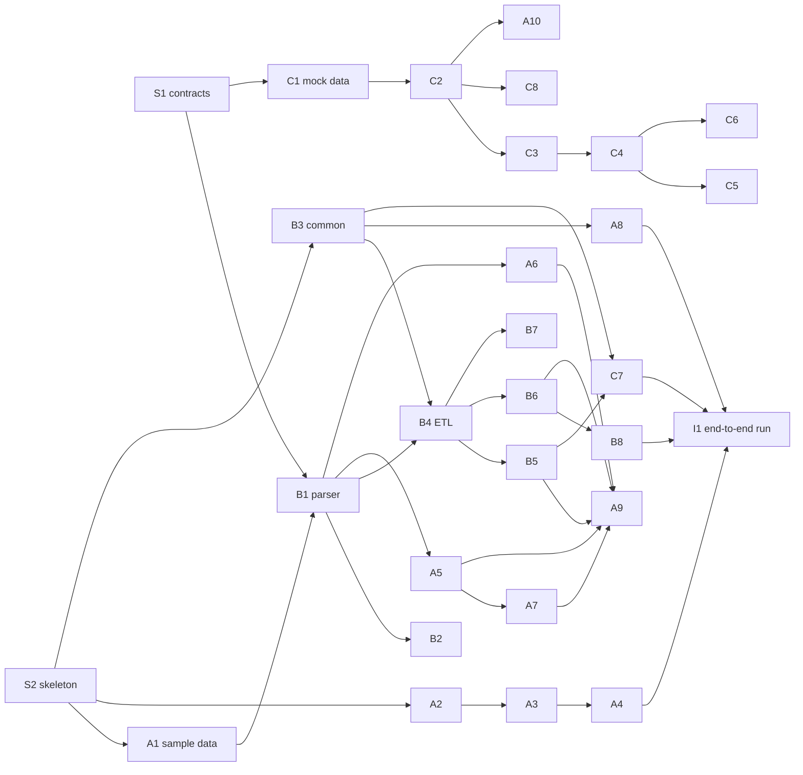

# Team Tasks — pick a track

The work is split into **three tracks of roughly equal size (~7.5–8 person-days each)**. Each member picks one track and owns every task in it. Module details (M1–M12) are in [PROJECT_PLAN.md](PROJECT_PLAN.md).

How to claim a task: put your name in **Owner**, open a GitHub Issue titled `[<ID>] <task>`, and work on the branch `feat/<ID>-<short-name>`.

Status values: `todo` · `in progress` · `review` · `done`

---

## Shared — Day 1 (all three together)

| ID | Task | Output | Est. | Owner | Status |
|----|------|--------|------|-------|--------|
| S1 | Review PROJECT_PLAN.md §2 defaults; freeze the §6 contracts into `docs/contracts/` | Contracts merged to `main` | 0.5d | all | todo |
| S2 | Repo skeleton: folders from §5, `.gitignore`, `.gitattributes` (LF), `requirements/*.txt`, empty `config/pipeline.yaml` with keys agreed | Skeleton PR | 0.25d | | todo |
| S3 | GitHub setup: protect `main`, require 1 review, create Issues for every task below, Project board | Board live | 0.25d | | todo |
| S4 | Each member installs Docker, Python, Java 17 and local PySpark, and confirms `pyspark` starts | Everyone can run local Spark | 0.25d | all | todo |

---

## Track A — Platform, Ingestion & MapReduce

*Good fit for someone comfortable with Docker, Linux and Hadoop configuration.*

| ID | Task | Module | Depends on | Est. | Owner | Status |
|----|------|--------|-----------|------|-------|--------|
| A1 | Download script with checksums and a mirror note; build the committed `data/sample/nasa_sample.log` (**do this on Day 1, everyone needs the sample**) | M2 | S2 | 0.5d | | todo |
| A2 | Hadoop images + config (HDFS, YARN, MapReduce on YARN, python3 on NodeManagers); pin versions in `docs/VERSIONS.md` | M1 | S2 | 1.5d | | todo |
| A3 | Spark master/worker + client container wired to HDFS; `lite` / `full` profiles; healthchecks; smoke tests (SparkPi, wordcount) | M1 | A2 | 1d | | todo |
| A4 | HDFS loader: create layout, decompress, upload, verify size, print `fsck` summary; idempotent | M2 | A1, A3 | 0.5d | | todo |
| A5 | MR job `status_count` (mapper, combiner, reducer, run script, local pipe test) | M6 | B1, A3 | 0.5d | | todo |
| A6 | MR job `hourly_traffic` | M6 | B1, A3 | 0.5d | | todo |
| A7 | MR job `top_resources` (2 stages, single-reducer top N) | M6 | A5 | 1d | | todo |
| A8 | Pipeline runner CLI `scripts/pipeline.py` (all stages, `--env`, `--only`, logging, fail-fast) | M10 | B3 | 1d | | todo |
| A9 | `compare_engines.py`: Spark vs MR result check + benchmark → `engine_benchmark` table | M9 | A5–A7, B5, B6 | 1d | | todo |
| A10 | Add the `dashboard` service to compose (with C) | M1 | C2 | 0.25d | | todo |

**Track A total ≈ 7.75 days**

---

## Track B — Parsing & Spark Processing

*Good fit for someone who likes data wrangling, SQL-style thinking and testing. Owns the critical path, so start immediately.*

| ID | Task | Module | Depends on | Est. | Owner | Status |
|----|------|--------|-----------|------|-------|--------|
| B1 | Shared parsing library: regex, `schema.py` (StructType, reason codes), `parse_line()` (**finish by Day 3: A5/A6 and B4 need it**) | M3 | S1, A1 | 1d | | todo |
| B2 | Parser unit tests (all edge cases) + Spark-vs-Python parity test | M3 / M11 | B1 | 0.5d | | todo |
| B3 | `common/`: config loader (`--env local|cluster`), Spark session factory (timezone P4), path resolver, logging | M4 | S2 | 0.5d | | todo |
| B4 | Spark ETL job: raw → parsed Parquet (partitioned) + rejected + `quality_report` | M4 | B1, B3 | 1d | | todo |
| B5 | Errors analytics job (status counts, hourly error rate, top 404 resources, top error hosts) + tests | M5a | B4 | 1d | | todo |
| B6 | Traffic analytics job (hourly/daily, hour-of-day + weekday profiles, peaks) + tests | M5b | B4 | 1d | | todo |
| B7 | Top-N analytics job (resources by hits/bytes, hosts, resource types) + tests | M5c | B4 | 0.5d | | todo |
| B8 | Anomaly detection job (hourly calendar, gaps, same-hour 7-day z-score, config thresholds) + tests | M5d | B6 | 1.5d | | todo |
| B9 | GitHub Actions CI: ruff + pytest (Java 17 + pyspark on the runner) | M11 | B2 | 0.5d | | todo |

**Track B total ≈ 7.5 days**

---

## Track C — Serving, Dashboard & Delivery

*Good fit for someone who likes web development and presentation. Owns what the examiner actually sees.*

| ID | Task | Module | Depends on | Est. | Owner | Status |
|----|------|--------|-----------|------|-------|--------|
| C1 | `dashboard/mock_data/`: realistic fake JSON for **every** table in §6.4, in the §6.5 format, plus `manifest.json` | M8 | S1 | 0.5d | | todo |
| C2 | Flask skeleton: app factory, config (`DATA_DIR`), blueprints, `services/repository.py` with caching + date filtering | M8a | C1 | 1d | | todo |
| C3 | All REST endpoints from §6.6 + param validation + error format + API tests | M8a / M11 | C2 | 1.5d | | todo |
| C4 | Frontend base: `base.html` layout + navigation, `api.js` helper, empty/error states, Overview page | M8b | C3 | 1d | | todo |
| C5 | Errors page + Traffic page (granularity toggle, date range) | M8b | C4 | 1d | | todo |
| C6 | Top N page + Anomalies page + Pipeline page (quality + benchmark) | M8b | C4 | 1d | | todo |
| C7 | Export job: analytics Parquet → serving JSON + manifest (size guard, ISO timestamps) | M7 | B3, B5 | 1d | | todo |
| C8 | Dashboard Dockerfile | M8 | C2 | 0.25d | | todo |
| C9 | README (quick start, screenshots, architecture), `docs/demo-script.md`; collect each owner's module notes | M12 | all | 0.75d | | todo |

**Track C total ≈ 8 days**

---

## Integration — Days 9–14 (all three)

| ID | Task | Lead | Status |
|----|------|------|--------|
| I1 | First full end-to-end run on the cluster (`pipeline.py all`) on one laptop | A | todo |
| I2 | Fix contract mismatches found in I1 | owner of the failing module | todo |
| I3 | Dashboard on real exported data; check every chart against the raw numbers | C | todo |
| I4 | Validate the anomaly output (does the August outage show as a gap?) and tune thresholds | B | todo |
| I5 | Run the `lite` profile on all three laptops | A | todo |
| I6 | Demo rehearsal ×2 (follow `demo-script.md`, time it) | C | todo |

---

## Dependency map (what unblocks what)

**Critical path:** S1 → B1 → B4 → B6 → B8 → I1. Keep B unblocked: A1 (sample data) and S1 (contracts) must land on Day 1.
